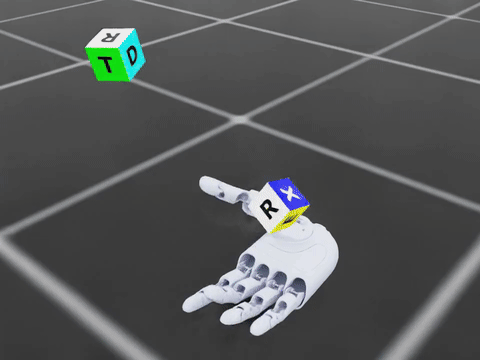
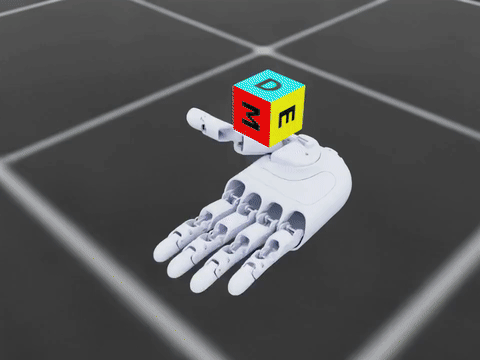
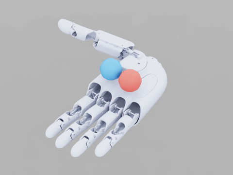

# GHand Isaac Lab

[English](README.md) | **简体中文**

基于 Isaac Lab 的 GHand5 右手灵巧操作项目，包含方块姿态重定向、方块持续旋转和双球掌内旋转三个任务。采用 RL-Games PPO 训练；持续旋转与双球任务还提供基于关节历史信息的学生策略及 EtherCAT 部署脚本。

## 任务与演示

| 方块姿态重定向 | 方块持续旋转 | 双球掌内旋转 |
|---|---|---|
|  |  |  |
| 将方块转到随机目标姿态 | 让方块绕指定轴连续旋转 | 两个球在手中相互绕转 |
| 方块边长 36 mm、质量 26.45 g | 边长 35–40 mm、质量 30–50 g 随机化 | 球直径 30 mm、每颗 15 g；手水平 |
| PPO · 检查点迭代数 12,000 | PPO＋域随机化 · 迭代数 206 | PPO · 迭代数 200 |
| [MP4 视频](media/cube_reorientation.mp4) | [MP4 视频](media/cube_spin.mp4) | [MP4 视频](media/dual_ball_rotation.mp4) |

演示均为约 15 秒、正常速度的仿真画面。迭代数来自所展示模型的检查点计数，不代表可以直接比较的总训练量。

| 任务目录 | Isaac Lab 任务 ID | 保留模型 |
|---|---|---|
| `cube_reorientation` | `Isaac-Reorient-Cube-GHand-v0` | 教师策略 |
| `cube_spin` | `Isaac-Spin-Cube-GHand-v0` | 教师与学生策略 |
| `dual_ball_rotation` | `Isaac-Dual-Ball-Rotation-GHand-v0` | 教师与学生策略 |

三个任务分别定义环境、奖励、观测和模型权重，共用手模型与公共工具。不同任务之间的策略不能互换。

## 环境配置

已验证版本为 **Isaac Lab 2.3.0 / Isaac Sim 5.1.0**。单独安装 Isaac Lab 后，在本仓库根目录执行命令：

```bash
export ISAACLAB_PATH="$HOME/workspace/IsaacLab"
# 可选：以可编辑模式安装
bash python.sh -m pip install --no-deps --no-build-isolation -e .
```

`python.sh` 会加入本项目 `source/` 和 Isaac Lab 的 Python 路径，默认使用 `$ISAACLAB_PATH/_isaac_sim/python.sh`。可通过 `ISAACSIM_PYTHON` 指定其他启动器。运行时需要保留与 `source/` 同级的 `assets/`、`config/`、`models/`；单独的 Python wheel 不包含全部运行资源。

## 仿真运行

```bash
# 方块重定向，同时显示参考目标
bash scripts/cube_reorientation/play.sh 4

# 方块持续旋转
bash python.sh scripts/cube_spin/evaluate.py \
  --checkpoint models/cube_spin/teacher/nn/policy.pth \
  --num_envs 4 --episodes_per_env 2 --output runs/cube_spin/view_teacher.json

# 双球掌内旋转
bash python.sh scripts/dual_ball_rotation/evaluate.py \
  --checkpoint models/dual_ball_rotation/teacher/nn/policy.pth \
  --num_envs 4 --episodes 3
```

学生策略仿真：

```bash
bash python.sh scripts/cube_spin/distill.py \
  --student models/cube_spin/student/student.pt \
  --num_envs 4 --episodes-per-env 1 --eval-output runs/cube_spin/view_student.json

bash python.sh scripts/dual_ball_rotation/evaluate.py \
  --student models/dual_ball_rotation/student/student.pt \
  --num_envs 4 --episodes 3
```

默认不录制视频；添加 `--headless` 可不打开窗口。方块和地面资源从 `assets/official/` 本地加载。

## 训练与蒸馏

```bash
bash python.sh scripts/cube_reorientation/train.py --headless --num_envs 4096
bash python.sh scripts/cube_spin/train.py --headless --num_envs 4096
bash python.sh scripts/dual_ball_rotation/train.py --headless --num_envs 1024 --max_iterations 300 --seed 42

bash python.sh scripts/cube_spin/distill.py --headless \
  --teacher models/cube_spin/teacher/nn/policy.pth \
  --run-dir runs/cube_spin/student_new --num_envs 256 --iterations 300

bash python.sh scripts/dual_ball_rotation/distill.py --headless \
  --teacher models/dual_ball_rotation/teacher/nn/policy.pth \
  --run-dir runs/dual_ball_rotation/student_new --num_envs 256 --iterations 300
```

PPO 参数位于 `config/<任务>/ppo.yaml`；环境参数由各任务的 `env_cfg.py` 定义。方块任务还会加载 `config/<任务>/env.yaml`。持续旋转从头训练默认使用固定物体设置；保留模型的尺寸、质量和摩擦随机化范围记录在 `models/cube_spin/teacher/params/env.yaml` 中。双球训练可通过 `GHAND_DUAL_BALL_BASE_CONFIG` 选择已有环境 YAML。

评估时先恢复所选模型的 `params/env.yaml`，再应用显式命令行参数；`params/agent.yaml` 记录对应 PPO 设置。这些模型配置及部署契约保留原始训练元数据。修改并行环境数量时，应满足 PPO 小批量大小的整除要求。

无视觉学生策略通过蒸馏学习教师行为，输入为关节观测和历史控制信息，不需要相机提供物体位姿。保留的双球学生策略在种子 123 下完成 64 次仿真测试，其中 63 次成功，平均转动 7.86 圈；成功定义为 30 秒内完成至少两圈且不掉球，详见[评估记录](models/dual_ball_rotation/student/evaluation.json)。这是固定初始条件下的仿真结果，不是真机成功率。

## 真机部署

使用安装了 PyTorch、PyYAML、GHand Python SDK 并支持 EtherCAT 的 Python 环境。只有显式指定 `--execute` 才执行真机动作。准备姿态时应为空手，固定设备并由现场人员操作。

```bash
export PYTHONPATH="$PWD/source${PYTHONPATH:+:$PYTHONPATH}"
export GHAND_SDK_ROOT="$HOME/ghand/GHand-Python-SDK"
export GHAND_ETHERCAT_INTERFACE=enx00e04c665f71  # 替换为实际 EtherCAT 网卡

# 方块持续旋转：先离线加载策略，再空手复位
python scripts/cube_spin/deploy.py \
  --policy-dir models/cube_spin/student \
  --output "runs/cube_spin/offline_$(date +%Y%m%d_%H%M%S).json"
python scripts/cube_spin/reset_hand.py --hand-side right --execute

# 放好方块，人员手撤离后运行
python scripts/cube_spin/deploy.py --hand-side right \
  --policy-dir models/cube_spin/student \
  --execute --object-present --duration 10 --speed 15 --torque 20 --onsite-cutoff-ready \
  --output "runs/cube_spin/hardware_$(date +%Y%m%d_%H%M%S).json"
```

```bash
# 双球掌内旋转：先离线加载，再空手到达模型起始姿态
python scripts/dual_ball_rotation/deploy.py --policy-dir models/dual_ball_rotation/student
python scripts/dual_ball_rotation/prepare_hand.py --policy-dir models/dual_ball_rotation/student \
  --execute --empty-hand --speed 25 --torque 25 --onsite-cutoff-ready

# 手保持水平并固定，放好两球，人员手撤离后运行
python scripts/dual_ball_rotation/deploy.py --policy-dir models/dual_ball_rotation/student \
  --execute --object-present --duration 10 --speed 25 --torque 25 --onsite-cutoff-ready
```

两个学生策略均以 20 Hz 发送位置指令。SDK 的速度、力矩百分比尚未标定为仿真的物理量；任务是否成功需要结合实际物体运动判断。方块重定向没有真机部署入口。双球部署每次覆盖 `runs/dual_ball_rotation/hardware/latest.json`，姿态准备单独记录。

## 代码结构

```text
assets/                        # 一份手模型、关节清单及本地方块/地面资源
config/<任务>/                 # PPO、环境与硬件配置
source/ghand/common/           # 手模型加载、配置恢复、关节及方块公共工具
source/ghand/tasks/<任务>/     # 各任务环境、奖励、学生网络和部署适配
scripts/<任务>/                # 训练、评估、蒸馏、部署、姿态准备或复位入口
models/<任务>/teacher/         # PPO 权重及匹配配置
models/<任务>/student/         # 学生权重、TorchScript 模型与部署契约
media/                         # 仿真 GIF 与 MP4
tests/<任务>/                  # 核心离线回归测试
```

每项任务的 `env.py` 实现仿真行为，`env_cfg.py` 定义配置。持续旋转的 `core.py`、`randomization.py`、`student.py` 分别处理控制与奖励计算、随机化和学生网络。双球的 `orbit.py` 计算旋转指标，`palm_frame.py` 处理掌面坐标，`perturbations.py` 处理随机化，`handover.py` 调度蒸馏中的控制权交接，`deployment.py` 和 `start_pose.py` 实现策略执行与初始姿态准备。两项方块任务共用的物理环境和随动关节复位逻辑位于 `common/inhand_env.py`、`cube_env.py`、`cube_env_cfg.py`。

```bash
PYTHONDONTWRITEBYTECODE=1 PYTHONPATH=source python -m unittest discover -s tests
```

训练日志、评估输出与缓存由 `.gitignore` 排除，模型权重和展示视频保留。

## 许可证

源码使用 [BSD-3-Clause](LICENSE) 许可证。GHand USD 和 NVIDIA 资源的权利归各自提供方所有，不受本项目源码许可证覆盖。
